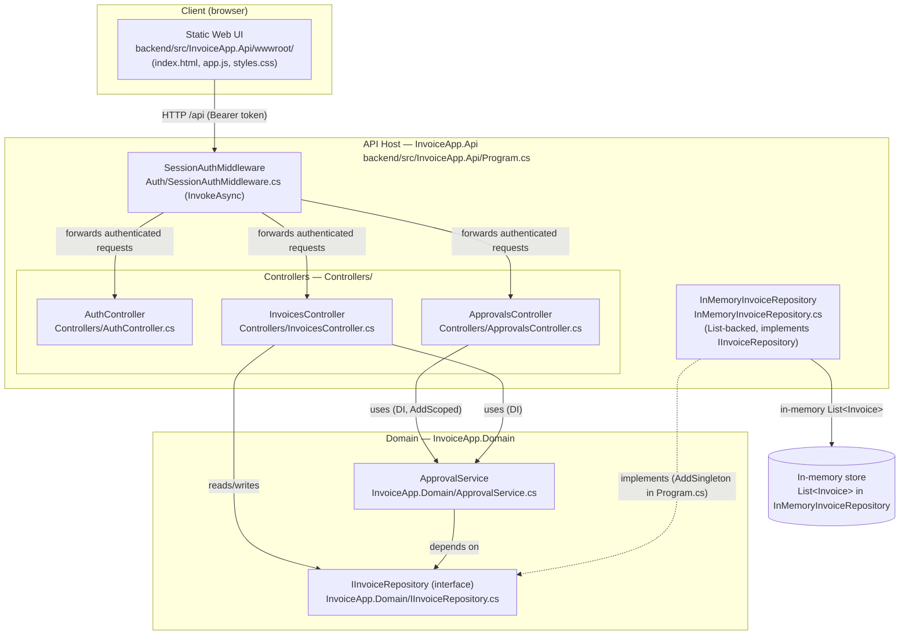
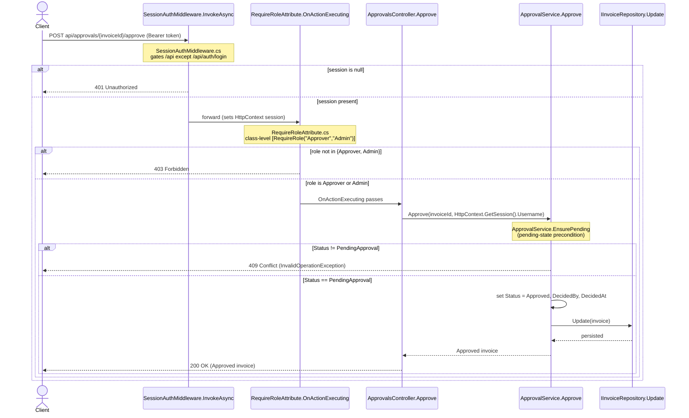

# As-Built Architecture — Invoice Approval Service

This document describes the Invoice Approval service **as it exists in the current codebase**. Every element in the diagrams below is traceable to a real file path or code symbol in the repository.

Persistence is **in-memory only**. Azure SQL, PayEx, and Azure Service Bus **do not exist** in the current code; they appear only in the target-state document (`target-state.md`) and the PayEx ADR (`adr/0001-payex-exactly-once.md`), always labeled as planned. Anything under `ops/` describes a *planned* deployment and is not current behavior.

## Container View

The container diagram shows the current runtime components. Each node is annotated with its real file path or code symbol.

Notes on grounding:

- The API host registers services in `Program.cs`: `AddSingleton<IInvoiceRepository, InMemoryInvoiceRepository>()` and `AddScoped<ApprovalService>()`, and wires the middleware with `app.UseMiddleware<SessionAuthMiddleware>()`.
- `InMemoryInvoiceRepository` backs persistence with a `List<Invoice>` field and is the only `IInvoiceRepository` implementation in the current code — there is no database.
- `ApprovalService` lives in the Domain project and depends only on the `IInvoiceRepository` interface, not on any web or storage type.

## Approval-Path Sequence

This sequence diagram traces an invoice approval request from the client through sign-in, the role gate, the controller, the domain service, and finally persistence. The ordering matches the control flow in the current code: `SessionAuthMiddleware.InvokeAsync` runs first, the `RequireRoleAttribute.OnActionExecuting` filter gates the action, `ApprovalsController.Approve` delegates to `ApprovalService.Approve`, which enforces the pending-state precondition via `EnsurePending` before calling `IInvoiceRepository.Update`.

Each interaction is cited to the real method/symbol that performs it. The route is `POST api/approvals/{invoiceId}/approve` (`[Route("api/[controller]")]` on the class plus `[HttpPost("{invoiceId}/approve")]` on the action). Approvals are restricted to the Approver or Admin roles by the class-level `[RequireRole("Approver", "Admin")]` attribute.

Interaction citations (each traced to a real symbol):

- Client request `POST api/approvals/{invoiceId}/approve` — `ApprovalsController` `[Route("api/[controller]")]` + `Approve` `[HttpPost("{invoiceId}/approve")]`
- Session check (401 if missing) — `SessionAuthMiddleware.InvokeAsync` (`backend/src/InvoiceApp.Api/Auth/SessionAuthMiddleware.cs`)
- Role gate Approver/Admin (403 if not allowed) — `RequireRoleAttribute.OnActionExecuting` (`backend/src/InvoiceApp.Api/Auth/RequireRoleAttribute.cs`), driven by the class-level `[RequireRole("Approver", "Admin")]`
- Controller action — `ApprovalsController.Approve` (`backend/src/InvoiceApp.Api/Controllers/ApprovalsController.cs`), calls `_approvals.Approve(invoiceId, HttpContext.GetSession().Username)`
- Domain approval — `ApprovalService.Approve` (`backend/src/InvoiceApp.Domain/ApprovalService.cs`), sets `Status = Approved` and calls `_repository.Update`
- Pending-state precondition (409 if not pending) — `ApprovalService.EnsurePending` (`backend/src/InvoiceApp.Domain/ApprovalService.cs`, a private internal detail invoked inside `Approve`; throws `InvalidOperationException`, which `ApiControllerBase.Handle` maps to 409)
- Persistence — `IInvoiceRepository.Update(Invoice invoice)` (`backend/src/InvoiceApp.Domain/IInvoiceRepository.cs`)

## Citations

Every element drawn in the container diagram and the sequence diagram is a **Cited_Element** unless it appears in the Inferred section below. Each citation resolves to a file path or code symbol that exists in the current repository.

### Container-view elements

| # | Diagram element | Cited file path / code symbol |
| --- | --- | --- |
| C1 | Static Web UI | `backend/src/InvoiceApp.Api/wwwroot/` (`index.html`, `app.js`, `styles.css`) |
| C2 | API Host — InvoiceApp.Api | `backend/src/InvoiceApp.Api/Program.cs` (host bootstrap, `WebApplication.CreateBuilder`) |
| C3 | SessionAuthMiddleware | `backend/src/InvoiceApp.Api/Auth/SessionAuthMiddleware.cs` — `SessionAuthMiddleware.InvokeAsync` |
| C4 | AuthController | `backend/src/InvoiceApp.Api/Controllers/AuthController.cs` — `AuthController` (route `api/auth`) |
| C5 | InvoicesController | `backend/src/InvoiceApp.Api/Controllers/InvoicesController.cs` — `InvoicesController` (route `api/[controller]`) |
| C6 | ApprovalsController | `backend/src/InvoiceApp.Api/Controllers/ApprovalsController.cs` — `ApprovalsController` (route `api/[controller]`) |
| C7 | InMemoryInvoiceRepository | `backend/src/InvoiceApp.Api/InMemoryInvoiceRepository.cs` — `InMemoryInvoiceRepository` |
| C8 | ApprovalService (Domain service) | `backend/src/InvoiceApp.Domain/ApprovalService.cs` — `ApprovalService` |
| C9 | IInvoiceRepository (interface) | `backend/src/InvoiceApp.Domain/IInvoiceRepository.cs` — `IInvoiceRepository` |
| C10 | In-memory store | `List<Invoice> _invoices` field in `backend/src/InvoiceApp.Api/InMemoryInvoiceRepository.cs` |
| C11 | Service / middleware registration | `Program.cs`: `AddSingleton<IInvoiceRepository, InMemoryInvoiceRepository>()`, `AddScoped<ApprovalService>()`, `app.UseMiddleware<SessionAuthMiddleware>()` |

### Sequence-diagram interactions

| # | Diagram interaction | Cited method / symbol |
| --- | --- | --- |
| C12 | Route `POST api/approvals/{invoiceId}/approve` | `ApprovalsController` `[Route("api/[controller]")]` + `Approve` `[HttpPost("{invoiceId}/approve")]` (`Controllers/ApprovalsController.cs`) |
| C13 | Role restriction `[RequireRole("Approver", "Admin")]` | class-level attribute on `ApprovalsController` (`Controllers/ApprovalsController.cs`) |
| C14 | Session check | `SessionAuthMiddleware.InvokeAsync` (`Auth/SessionAuthMiddleware.cs`) |
| C15 | Role gate enforcement | `RequireRoleAttribute.OnActionExecuting` (`Auth/RequireRoleAttribute.cs`) |
| C16 | Controller action | `ApprovalsController.Approve` → `_approvals.Approve(invoiceId, HttpContext.GetSession().Username)` (`Controllers/ApprovalsController.cs`) |
| C17 | Domain approval (set `Status = Approved`) | `ApprovalService.Approve` (`InvoiceApp.Domain/ApprovalService.cs`) |
| C18 | Pending-state precondition | `ApprovalService.EnsurePending` — `private static void` invoked inside `Approve` (`InvoiceApp.Domain/ApprovalService.cs`) |
| C19 | Persistence write | `IInvoiceRepository.Update(Invoice invoice)` (`InvoiceApp.Domain/IInvoiceRepository.cs`), implemented by `InMemoryInvoiceRepository.Update` |
| C20 | 409 Conflict mapping | `ApiControllerBase.Handle` maps `InvalidOperationException` → `Conflict` (`Controllers/ApiControllerBase.cs`) |
| C21 | Client identity source | `HttpContextExtensions.GetSession()` (`Auth/SessionAuthMiddleware.cs`) |

## Inferred

The following diagram elements are **Inferred_Elements**. They are not single code symbols; they are reasonable inferences drawn from the code, from HTTP/ASP.NET Core runtime behavior, or from the composition expressed across files. Each appears here and **not** in the Citations list, so every diagram element is in exactly one of the two lists.

| # | Inferred element | Rationale (why it is inferred, not a single cited symbol) |
| --- | --- | --- |
| I1 | "Client (browser)" actor | The external caller is not a file or type in this repository. It is the human/browser that loads the static UI and issues HTTP requests; it is inferred as the origin of the flow. |
| I2 | HTTP transport + `Bearer` token edges (UI → API, Client → middleware) | The arrows represent the HTTP request/response channel and the `Authorization: Bearer <token>` header. These are runtime transport facts (ASP.NET Core request pipeline) rather than a single symbol; the `Bearer ` prefix is read in `SessionAuthMiddleware`/`AuthController`, but the "edge" itself is an inference about transport. |
| I3 | DI "uses" / "depends on" relationship arrows | The arrows between controllers → `ApprovalService`, `InvoicesController` → `IInvoiceRepository`, and `ApprovalService` → `IInvoiceRepository` are inferred from constructor injection plus the `Program.cs` registrations. No single line of code states "ApprovalsController uses ApprovalService"; it is composed by the DI container. |
| I4 | "implements" edge (`InMemoryInvoiceRepository` ⟶ `IInvoiceRepository`) | Inferred from the class declaration `: IInvoiceRepository` combined with the `AddSingleton<IInvoiceRepository, InMemoryInvoiceRepository>()` binding in `Program.cs`. Shown as a relationship rather than a callable symbol. |
| I5 | Status-code outcomes 401 / 403 / 409 / 200 | These are inferred end-to-end outcomes of the pipeline: 401 from `SessionAuthMiddleware` (`StatusCodes.Status401Unauthorized`), 403 from `RequireRoleAttribute` (`StatusCodes.Status403Forbidden`), 409 from `ApiControllerBase.Handle` mapping an `InvalidOperationException`, and 200 from the controller returning `Ok(...)`. The numeric codes are assembled from behavior across middleware, filter, and base controller rather than stated together in one place. |

## Corrections

Corrections record any element that was first drafted in a way that contradicted the codebase, together with the verified corrected form. Each was fixed by reading the actual source under `backend/`.

| # | Original draft | Codebase contradiction | Corrected form |
| --- | --- | --- | --- |
| X1 | `EnsurePending` was initially described as if it were a callable/public precondition method (an externally invocable check). | `backend/src/InvoiceApp.Domain/ApprovalService.cs` declares it `private static void EnsurePending(Invoice invoice)` — it is a private helper, not part of the public surface, and is invoked only from inside `Approve` (and `Reject`). | Described as a **private static** method invoked inside `ApprovalService.Approve` (and `ApprovalService.Reject`) that throws `InvalidOperationException` when `Status != PendingApproval`; it is not independently callable from controllers. The sequence-diagram note and citation C18 reflect this. |

No other drafted element required correction: all remaining cited file paths and symbols (C1–C21) were verified to resolve against the current repository, and no citation pointed to a non-existent file or symbol. The single recorded correction above (X1, the `EnsurePending` visibility/role clarification) is the only contradiction found and corrected.
