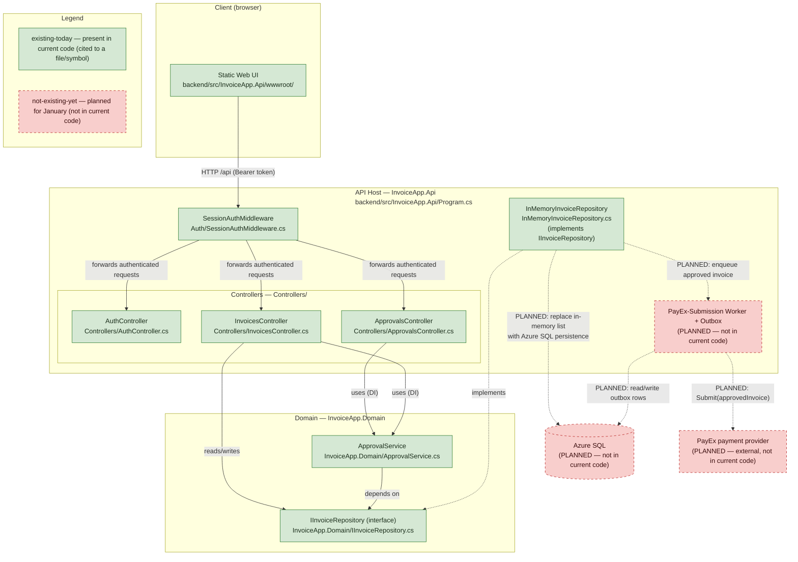
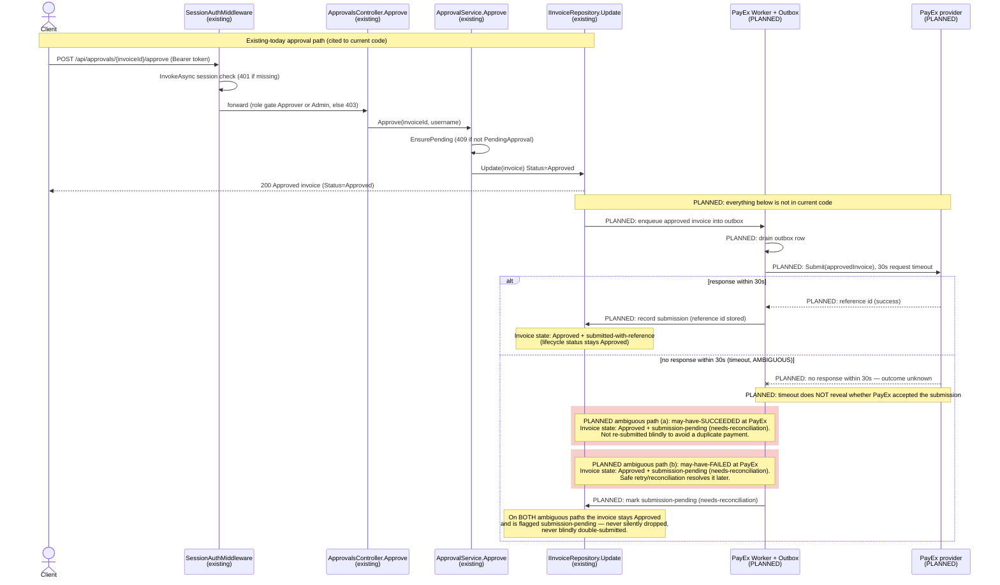

# Target-State Architecture — Invoice Approval Service

This document describes the Invoice Approval service **as it is planned to look** after the January transition to a tier-2, 24x7 service, once **Azure SQL persistence** and the **PayEx** payment-submission integration are added. It reuses the as-built components (`as-built.md`) and layers the new, not-yet-built components on top.

Two visual styles distinguish what exists today from what is planned:

- **existing-today** — components already present in the current codebase, each cited to a real file path or code symbol (the same citations used in `as-built.md`).
- **not-existing-yet** — components that **do not exist** in the current code and are planned for January: **Azure SQL**, the **PayEx integration**, the **PayEx-submission worker/outbox**, and **Azure Service Bus**.

Do not read the planned components as current behavior. They are drawn only to plan the January change.

## Planned Deployment Note

Azure SQL, PayEx, and Azure Service Bus **do not exist** in the current code. They are drawn here with the **not-existing-yet** style purely to plan the January work and are **never** cited to a code file or symbol.

The `ops/` folder describes this **planned** production deployment — a database, a message topic, and a payment provider — none of which exist in the code today (per `AGENTS.md`). Any reference to `ops/` material in this document is a **planned deployment**, not a description of how the system behaves now. The not-existing-yet nodes below (Azure SQL, Azure Service Bus message topic, PayEx) correspond to that planned `ops/` deployment and must not be treated as current behavior.

The invoice business logic and lifecycle (Draft, PendingApproval, Approved, Rejected) in `ApprovalService` are **unchanged** by this target state; the new components attach around the existing flow rather than altering it.

## Target Container View

The container diagram below reuses the as-built components with the **existing-today** style and adds the planned Azure SQL, PayEx, and PayEx-submission worker/outbox with the **not-existing-yet** style. A legend subgraph maps each of the two styles to its state.

### Existing-today components (cited to current code)

Each existing-today node resolves to a real location in the current repository (same citations as `as-built.md`):

| Component | Style | Cited file path / symbol |
| --- | --- | --- |
| Static Web UI | existing-today | `backend/src/InvoiceApp.Api/wwwroot/` (`index.html`, `app.js`, `styles.css`) |
| API Host — InvoiceApp.Api | existing-today | `backend/src/InvoiceApp.Api/Program.cs` |
| SessionAuthMiddleware | existing-today | `backend/src/InvoiceApp.Api/Auth/SessionAuthMiddleware.cs` |
| AuthController | existing-today | `backend/src/InvoiceApp.Api/Controllers/AuthController.cs` |
| InvoicesController | existing-today | `backend/src/InvoiceApp.Api/Controllers/InvoicesController.cs` |
| ApprovalsController | existing-today | `backend/src/InvoiceApp.Api/Controllers/ApprovalsController.cs` |
| InMemoryInvoiceRepository | existing-today | `backend/src/InvoiceApp.Api/InMemoryInvoiceRepository.cs` |
| ApprovalService | existing-today | `backend/src/InvoiceApp.Domain/ApprovalService.cs` |
| IInvoiceRepository (interface) | existing-today | `backend/src/InvoiceApp.Domain/IInvoiceRepository.cs` |

### Not-existing-yet components (planned — not cited to code)

These carry the **not-existing-yet** style and are **not** traceable to any current file or symbol:

| Component | Style | Status |
| --- | --- | --- |
| Azure SQL (persistence) | not-existing-yet | Planned January deployment; replaces the in-memory `List<Invoice>`. Not in current code. |
| PayEx-submission worker + outbox | not-existing-yet | Planned; drains an outbox and submits approved invoices to PayEx. Not in current code. |
| PayEx payment provider | not-existing-yet | Planned external integration; receives approved invoices. Not in current code. |
| Azure Service Bus message topic | not-existing-yet | Planned transport referenced by `ops/`; not in current code. |

> Note: In the diagram the planned persistence and transport are consolidated into the **Azure SQL** node and the **PayEx-Submission Worker + Outbox** node. The Azure Service Bus message topic is part of the same planned `ops/` deployment and shares the not-existing-yet style; it is detailed further in the target sequence diagram and the PayEx ADR.

## Target Approval-and-Submission Sequence

The sequence diagram below extends the as-built approval path (`as-built.md`) into the **planned** PayEx submission. The existing approval interactions are reused unchanged and cited to their real symbols; every PayEx-related interaction is **planned** and does not exist in the current code.

Because Mermaid sequence diagrams cannot apply `classDef` styles to individual messages, the two states are denoted on the messages themselves:

- **existing-today** — a message between the four existing participants, cited to a real symbol. No prefix.
- **not-existing-yet** — any PayEx / worker / outbox interaction, marked with a **`PLANNED:`** prefix on the message text and in `Note` blocks.

This mirrors the two-style legend used in the Target Container View above (existing-today vs not-existing-yet).

**Legend (same convention as the Target Container View):**

- **existing-today** — messages with no `PLANNED:` prefix, between `SessionAuthMiddleware` (`InvokeAsync`), `ApprovalsController.Approve`, `ApprovalService.Approve` (and its `EnsurePending` precondition), and `IInvoiceRepository.Update`. Each is cited below.
- **not-existing-yet** — every message or note prefixed `PLANNED:` (the worker/outbox, `Submit(approvedInvoice)`, the PayEx response handling, the reference id, and the timeout branch). None of these exist in the current code.

### Existing-today interactions (cited to current code)

| Interaction | Style | Cited symbol |
| --- | --- | --- |
| Session check on every `/api` call | existing-today | `SessionAuthMiddleware.InvokeAsync` — `backend/src/InvoiceApp.Api/Auth/SessionAuthMiddleware.cs` |
| Role gate (Approver or Admin) | existing-today | `[RequireRole("Approver", "Admin")]` on `ApprovalsController` — `backend/src/InvoiceApp.Api/Controllers/ApprovalsController.cs` |
| Approve endpoint `POST api/approvals/{invoiceId}/approve` | existing-today | `ApprovalsController.Approve` — `backend/src/InvoiceApp.Api/Controllers/ApprovalsController.cs` |
| Domain approval + pending precondition | existing-today | `ApprovalService.Approve`, `ApprovalService.EnsurePending` — `backend/src/InvoiceApp.Domain/ApprovalService.cs` |
| Persist the approved invoice | existing-today | `IInvoiceRepository.Update` — `backend/src/InvoiceApp.Domain/IInvoiceRepository.cs` |

### Not-existing-yet interactions (planned — not cited to code)

| Interaction | Style | Status |
| --- | --- | --- |
| Enqueue approved invoice into outbox | not-existing-yet | Planned worker/outbox; not in current code. |
| Worker drains outbox row | not-existing-yet | Planned; not in current code. |
| `Submit(approvedInvoice)` to PayEx (30s timeout) | not-existing-yet | Planned external call; not in current code. |
| PayEx reference id on success | not-existing-yet | Planned response handling; not in current code. |
| Timeout branch (ambiguous success/fail) | not-existing-yet | Planned; not in current code. |
| Record submission / mark submission-pending | not-existing-yet | Planned submission-status tracking; not in current code. |

### Invoice lifecycle note

The invoice **lifecycle states remain exactly `Draft`, `PendingApproval`, `Approved`, and `Rejected`** (`backend/src/InvoiceApp.Domain/InvoiceStatus.cs`), unchanged by this target state. The 30-second timeout handling does **not** add a new lifecycle state: on every path the invoice stays `Approved`, and the *submission status* (submitted-with-reference vs submission-pending / needs-reconciliation) is tracked **separately** from the lifecycle. On both ambiguous timeout paths the invoice remains `Approved` and submission-pending — it is neither silently dropped nor blindly re-submitted, so no duplicate payment is created before reconciliation resolves the true outcome.
